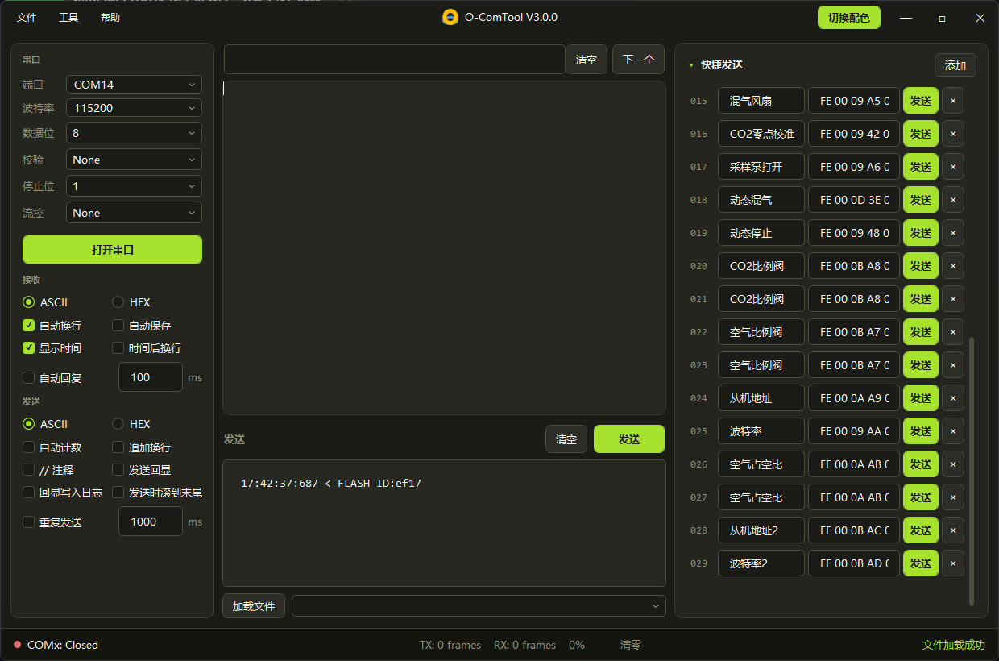

# O-Comtool


O-Comtool 是一款简单易用的串口调试助手。当前版本用 .NET 10 WPF 重写，把串口收发和界面拆开，方便继续加功能。

# 版本对照

| 分支 / 标签 | 版本 | 技术栈 | 状态 |
| --- | --- | --- | --- |
| `refactor/net10-wpf` | V3.0 | .NET 10 + WPF + AvalonEdit | 重构验证中，尚未正式发布 |
| `master` / `v2.1.1` | V2.1.1 | .NET Framework 4.8 + WinForms + FastColoredTextBox | 稳定版，长期可用 |

# 特性
* 支持串口参数设置，支持常用波特率选择与波特率自定义
* 支持实时刷新串口，插入新设备即可切换端口，无需重启软件
* 支持 ASCII 与 HEX 显示，明码暗码轻松切换
* 接收区识别 ANSI 颜色日志，包括 16 色、256 色和真彩色；写入日志时去掉控制符
* 支持收发信息时间显示，自动换行，发送回显，轻松显示交互逻辑
* 支持自动计数与重复发送，丢帧与否，一眼便知
* 支持 `//` 报文注释，报文含义清晰可见
* 支持报文校验和、异或、CRC16 Modbus、CRC32，报文组包快人一步
* 支持加载文件报文，预先导入报文
* 接收区关键字高亮用 `%AppData%/O-ComTool/highlight.json` 配置，写法接近 VS Code 的 settings.json，保存后自动重新着色
* 支持实时搜索，可以实时查找关键字，第一时间发现问题
* 快捷发送最多 100 条，可增删、改名、单条发送，侧栏可以收起
* 接收区可勾选自动保存，按文件夹把日志落到磁盘
* 支持软件名称备注，轻松区别多个串口设备
* 界面设置保存在 `%AppData%/O-ComTool/settings.json`，仍可导入、导出旧版 ini
* 深色界面，右上角可切换浅色方案
* 更有校验、HEX 格式化、ASCII 表等小工具

# 软件截图

## 新版界面（V3.0）



深色为主题，右上角可切换浅色。左侧是串口、接收、发送三组设置，中间是接收区和发送框，右侧是可收起的快捷发送列表，底部状态栏显示串口状态与 TX/RX 计数。

## 旧版界面（V2.1.1）


旧版为浅灰 WinForms 风格，只有接收区是黑底。左边是串口和收发设置，右上接收区，右下发送区，底部状态栏；“工具 - 选项设置”里可以按颜色自定义接收区的正则高亮规则。

# 使用方法
请参考如下链接：

[V1.1.0](http://www.ifreehub.com/archives/3/)

[V2.0.0](http://www.ifreehub.com/archives/13/)

[V2.1.0](http://www.ifreehub.com/archives/24/)

V3.0 的使用说明待补充。界面变化主要在深色主题、JSON 配置和高亮规则，基本操作思路与旧版一致。

# 如何编译
## 环境

* .NET 10 SDK
* 打开 `O-ComTool.sln`，启动项目为 `src/O-ComTool.App`（WPF，`net10.0-windows`）

## 运行

```
dotnet run --project src/O-ComTool.App
```

解决方案分为两个项目：

* `src/O-ComTool.Core`：串口会话、组帧、发送编码、校验、ANSI 解析和高亮，不依赖界面
* `src/O-ComTool.App`：WPF 主窗口。接收区使用 AvalonEdit，只给可见行着色

配置写在 `%AppData%/O-ComTool/settings.json`。接收区高亮写在同目录的 `highlight.json`。旧版 `O-ComTool_Pro` WinForms 工程仍留在仓库中，不参与这个解决方案的编译。

## 旧版 WinForms

* Visual Studio 2017
* .NET Framework 4.8
* 打开 `O-ComTool_Pro.sln`

# 提示与注意事项
* WPF 项目的目标框架是 `net10.0-windows`，只能在 Windows 上编译和运行，Linux / macOS 上需要 Windows 机器或虚拟机
* 目前重构版没有自动构建，发布前请自己在本机编译验证；有问题请到 Issue 反馈并附上复现步骤
* 配置从 ini 迁到 `%AppData%/O-ComTool/settings.json`，接收区高亮在 `%AppData%/O-ComTool/highlight.json`，高亮文件保存后自动重新着色
* 旧版 ini 配置仍可导入、导出，换版本时不用手动重填参数
* 快捷发送上限由 30 条提升到 100 条，侧栏可以收起
* 旧版 `O-ComTool_Pro` WinForms 工程保留在仓库里方便对照，但不参与 `O-ComTool.sln` 的编译

# 作者有话说
由于作者主要做嵌入式开发，当时开发这个软件也是出于工作须要，现学现卖，**面向搜索引擎编程**，代码质量一般，原本计划基于QT重构该软件，但是如今工作繁忙，无力优化与维护，欢迎各位大佬继续优化或者添加新功能，欢迎重构。

# 贡献者
感谢为这个项目提交代码和改进建议的同学：

* [@lanlinggit](https://github.com/lanlinggit)：V3.0 .NET 10 WPF 重构（[PR #3](https://github.com/vesamount/O-ComTool/pull/3)），Core / App 分层、深色主题、ANSI 颜色日志解析、JSON 高亮配置、快捷发送扩展到 100 条。旧版 WinForms 工程按他的方案留在仓库里作对照。

# 致谢
新版接收区使用 [AvalonEdit](https://github.com/icsharpcode/AvalonEdit)。旧版 WinForms 使用 [FastColoredTextBox](https://github.com/PavelTorgashov/FastColoredTextBox)。

# License
[GPL-3.0](https://www.gnu.org/licenses/gpl-3.0.html)
